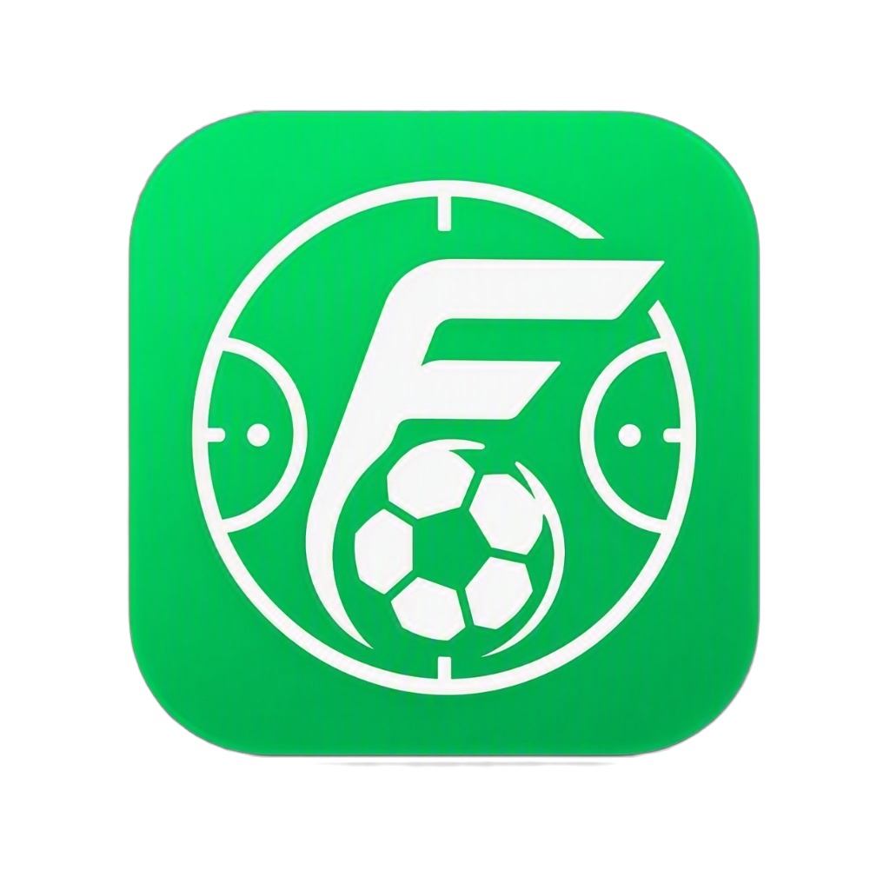
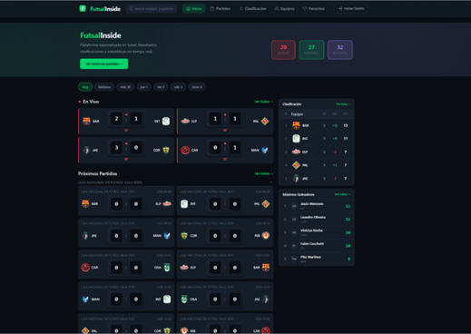

<div align="center">



# ⚽ FutsalInside

**Plataforma de resultados y estadísticas de fútbol sala en tiempo real**

[](https://angular.dev)
[](https://laravel.com)
[](https://www.php.net)
[](https://www.typescriptlang.org)
[](https://vitest.dev)
[](frontend/)
[](#-sobre-el-proyecto)

*Interfaz oscura inspirada en SofaScore / FlashScore · 100% en español · Responsive*

[✨ Características](#-características) · [🚀 Puesta en marcha](#-puesta-en-marcha) · [🏗 Arquitectura](#-arquitectura) · [📡 API](#-api-rest)

</div>

---

## 📸 Capturas

> Añade aquí tus capturas de pantalla (Home, Partidos en vivo, Detalle de partido, Clasificación, Detalle de jugador…):

```markdown
| Home | En vivo | Detalle de partido |
|:---:|:---:|:---:|
|  |  |  |
```

---

## ✨ Características

### 🏠 **Inicio**
- Partidos **en vivo destacados** con priorización de favoritos.
- **Mini clasificación** y **máximos goleadores** de cada competición.
- Partidos de tus equipos **favoritos** en un solo bloque.
- Jornadas agrupadas por competición con colapso por liga.

### 📺 **En vivo**
- Seguimiento de todos los partidos con estado `live` / `descanso`.
- Actualización continua del marcador y del minuto.

### 🗓 **Partidos**
- Listado por fecha con filtros por competición.
- **Detalle de partido** con pestañas: **Información**, **Eventos** (goles, asistencias, tarjetas, MVP) y **Estadísticas** (7 métricas por equipo).

### 🏆 **Clasificación**
- Tablas de posiciones por competición: puntos, jugados, ganados, empatados, perdidos, goles y diferencia.

### 🛡 **Equipos**
- Fichas de equipo con plantilla, calendario y **estadísticas del equipo**.
- **Gráfico radar** de rendimiento por club.

### 🧑‍🎤 **Jugadores**
- Ficha completa: posición, edad, valor de mercado, carrera profesional.
- **Gráfico radar** de atributos, **timeline de carrera**, estadísticas avanzadas y **partidos jugados**.
- Mapa de posición en pista (`player-position-pitch`).

### ⭐ **Favoritos & Auth**
- Registra/Login con **JWT (Sanctum)** y favoritos sincronizados con la API.
- Guardas funcionales: `authGuard` (protege `/favorites`) y `guestGuard` (oculta login/registro a usuarios logueados).

### 🔍 **Extras**
- **Búsqueda global** en la cabecera (equipos, jugadores, partidos).
- Breadcrumbs, estados vacíos, **skeletons** de carga e imágenes diferidas (`IntersectionObserver`).
- Tema oscuro con variables CSS (`src/styles/_variables.css`) y utilidades tipo Tailwind propias.

---

## 🛠 Tecnologías

### Frontend — `frontend/`
| Tecnología | Versión | Uso |
|---|---|---|
| [Angular](https://angular.dev) | 21 | Framework SPA (standalone components, signals, lazy loading) |
| TypeScript | 5.9 | Tipado estricto |
| RxJS | 7.8 | Streams asíncronos |
| [Vitest](https://vitest.dev) | 4 | Unit testing |
| CSS puro | — | Variables custom + utilidades propias (sin frameworks CSS) |

### Backend — `backend/`
| Tecnología | Versión | Uso |
|---|---|---|
| [Laravel](https://laravel.com) | 13 | API REST |
| PHP | 8.3 | Lenguaje servidor |
| [Laravel Sanctum](https://laravel.com/docs/sanctum) | 4 | Autenticación por token (7 días) |
| SQLite | — | Base de datos (por defecto) |

---

## 🏗 Arquitectura

```
┌─────────────────────────────────────────────────────────────┐
│                     Angular 21 (SPA)                        │
│  ┌───────────┐  ┌──────────────┐  ┌──────────────────────┐  │
│  │  Features  │→ │ Signal Stores│→ │  DataService (seam)  │  │
│  │ lazy routes│  │ (matches,    │  │  ├─ ApiDataService   │──┼──► Laravel API
│  └───────────┘  │  standings…) │  │  └─ MockDataService  │  │    (Sanctum)
│                 └──────────────┘  └──────────────────────┘  │
└─────────────────────────────────────────────────────────────┘
```

**Decisiones clave:**

- **`DataService` como seam** (`frontend/src/app/core/services/data.service.ts`): contrato abstracto consumido por todas las stores. `ApiDataService` y `MockDataService` lo implementan con semántica idéntica; se cambia con un flag en `environment.ts` → `useApi: true|false`. Ninguna página conoce la fuente de datos.
- **Signal stores** en `src/app/stores/` (`signal()`, `computed()`, `asReadonly()`) — sin NgRx.
- **Standalone components** sin NgModules; cada componente declara sus propios `imports`.
- **Rutas lazy** por feature (`loadChildren` / `loadComponent`).
- **Tres layouts**: `main-layout` (header + footer), `auth-layout`, `blank-layout`.
- **Guards/interceptores funcionales**: `auth.guard`, `auth.interceptor`, `error.interceptor`.
- **API pública solo-lectura** + mutaciones autenticadas: las rutas GET no requieren token; login, logout y favoritos sí (`auth:sanctum`).

---

## 📡 API REST

Base URL local: `http://localhost:8000/api`

### Públicas (solo lectura)
| Método | Endpoint | Descripción |
|---|---|---|
| GET | `/competitions` | Competiciones |
| GET | `/standings` | Clasificaciones |
| GET | `/teams` · `/teams/{id}` | Equipos |
| GET | `/teams/{id}/statistics` | Estadísticas de equipo |
| GET | `/players` · `/players/{id}` | Jugadores |
| GET | `/players/{id}/statistics` | Estadísticas de jugador |
| GET | `/players/{id}/matches` | Partidos de un jugador |
| GET | `/player-statistics` | Todas las estadísticas |
| GET | `/matches` · `/matches/{id}` | Partidos |

### Autenticación (`/auth/*`)
| Método | Endpoint | Descripción |
|---|---|---|
| POST | `/auth/register` | Registro (token Sanctum, 7 días) |
| POST | `/auth/login` | Login |
| POST | `/auth/logout` | Logout 🔒 |
| GET | `/auth/me` | Usuario actual 🔒 |

### Datos de usuario 🔒
| Método | Endpoint | Descripción |
|---|---|---|
| GET | `/favorites` | Favoritos del usuario |
| POST | `/favorites/toggle` | Añadir/quitar favorito |

> 🔒 = requiere header `Authorization: Bearer {token}`

---

## 🚀 Puesta en marcha

### Prerequisitos
- **Node.js** ≥ 20 y npm
- **PHP** 8.3+ y **Composer**
- (Opcional) SQLite 3 — ya incluido en la mayoría de sistemas

### 1. Backend (Laravel)

```bash
cd backend

composer install
cp .env.example .env          # Windows: copy .env.example .env
php artisan key:generate

# Crear la base de datos SQLite (si no existe)
touch database/database.sqlite   # Windows: New-Item database/database.sqlite

php artisan migrate --seed       # Migraciones + datos de ejemplo + usuario demo
php artisan serve                # → http://localhost:8000
```

El seed crea **5 competiciones, 34 equipos, jugadores, partidos, estadísticas y carreras**, más un usuario de prueba:

| Campo | Valor |
|---|---|
| Email | `admin@futsalinside.test` |
| Contraseña | `password` |

### 2. Frontend (Angular)

```bash
cd frontend
npm install
npm start                        # → http://localhost:4200
```

### 3. Conexión frontend ↔ backend

En `frontend/src/environments/environment.ts`:

```ts
export const environment = {
  production: false,
  apiUrl: 'http://localhost:8000/api',
  appName: 'FutsalInside',
  useApi: true,   // false → datos mock (sin backend)
};
```

> Con `useApi: false` la app funciona **sin backend** usando `MockDataService` (datos simulados con delay de 300 ms).

---

## 📁 Estructura del proyecto

```
TFM_FutsalInside/
├── frontend/                          # Angular 21
│   └── src/app/
│       ├── core/
│       │   ├── api/                   # Configuración de API
│       │   ├── auth/                  # AuthService, guards
│       │   ├── interceptors/          # auth & error interceptors
│       │   ├── mocks/                 # Datos mock
│       │   ├── models/                # Interfaces (Team, Match, Player…)
│       │   └── services/              # DataService · Api/Mock implementations
│       ├── stores/                    # Signal stores (matches, standings…)
│       ├── features/                  # home · live · matches · standings
│       │   │                          # teams · players · favorites · auth
│       ├── shared/
│       │   ├── components/            # header, match-card, radar-chart…
│       │   ├── pipes/                 # match-status, time-ago… (en español)
│       │   └── directives/            # lazy-image (IntersectionObserver)
│       ├── layouts/                   # main-layout · auth-layout · blank-layout
│       └── styles/                    # _variables.css · _utilities.css
│
└── backend/                           # Laravel 13
    ├── app/Http/Controllers/Api/      # Competitions, Matches, Teams, Players…
    ├── app/Models/                    # Eloquent models
    ├── routes/api.php                 # Rutas REST + auth
    └── database/
        ├── migrations/                # Esquema relacional
        └── seeders/                   # Datos de ejemplo (JSON)
```

---

## 🧪 Tests

```bash
# Frontend — Vitest
cd frontend
npm test

# Backend — PHPUnit
cd backend
composer test          # o: php artisan test
```

---

## 📈 Estado del proyecto

| Fase | Estado |
|---|---|
| UI (todas las features) | ✅ Completada |
| API REST + autenticación | ✅ Completada |
| Seed de datos realistas | ✅ Completado |
| Integración Angular ↔ API | ✅ `useApi: true` |
| Despliegue (frontend + API) | 🚧 Pendiente |
| Tests E2E | 🚧 Pendiente |

---

## 📚 Sobre el proyecto

**FutsalInside** es el desarrollo realizado como **Trabajo de Fin de Máster (TFM)**: una aplicación web full-stack de fútbol sala con resultados en vivo, estadísticas avanzadas de equipos y jugadores (gráficos radar, timelines de carrera) y experiencia de usuario tipo SofaScore/FlashScore.

<div align="center">

**Autor:** [ags2120](https://github.com/ags2120)

</div>
```
